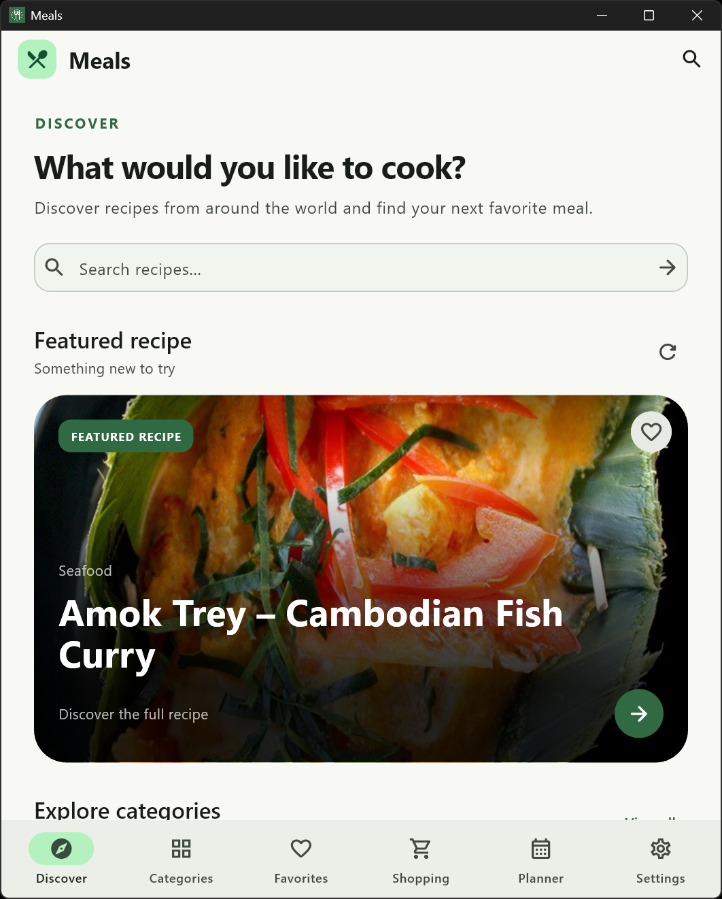
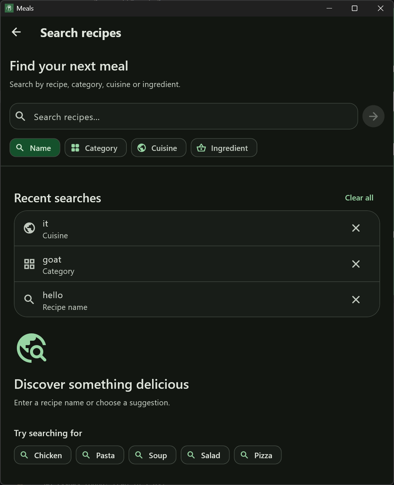
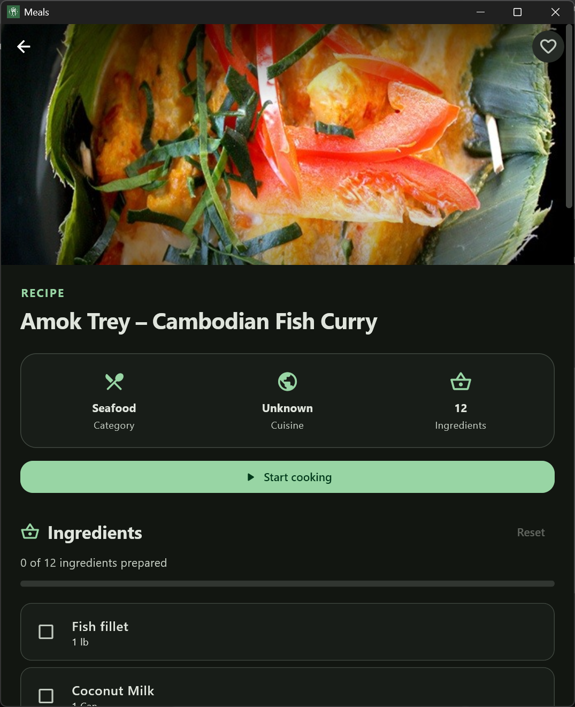
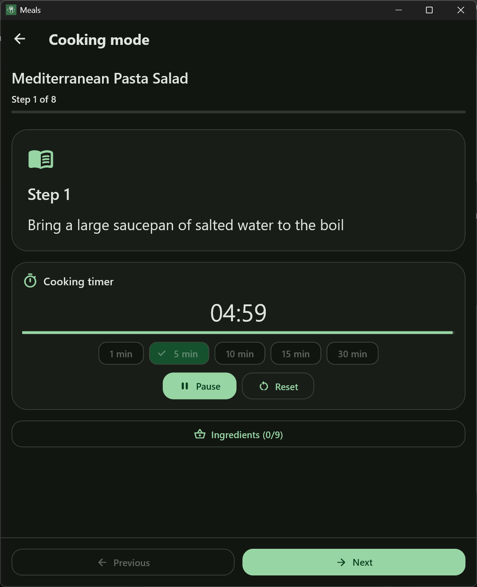
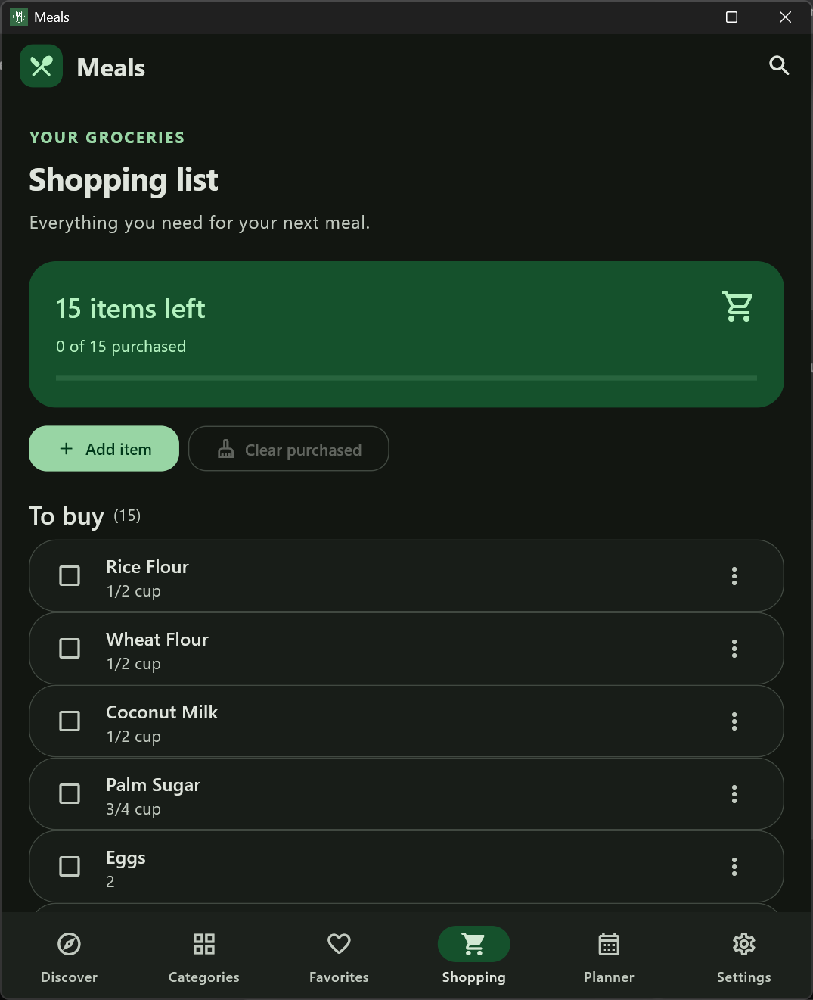
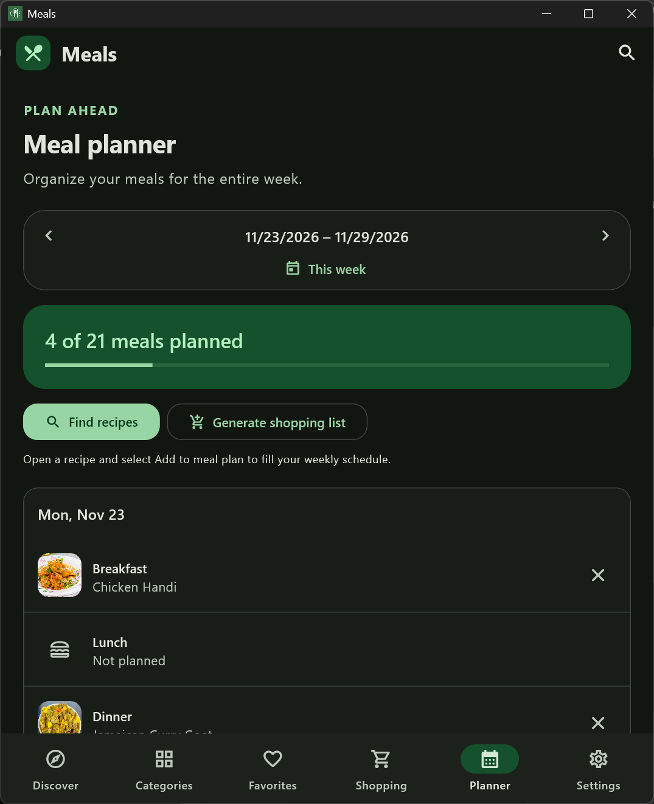
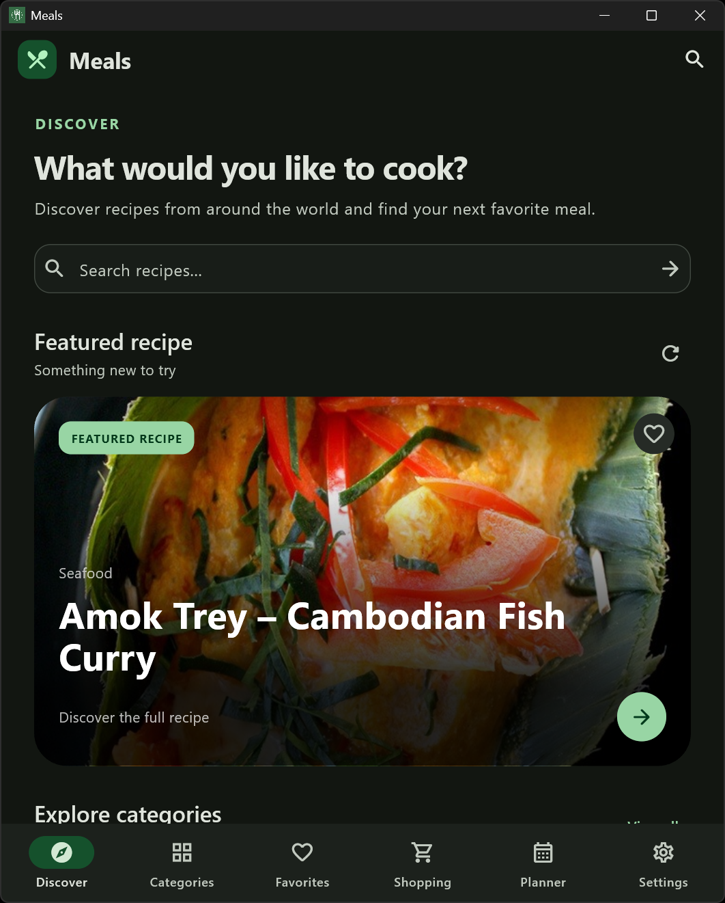
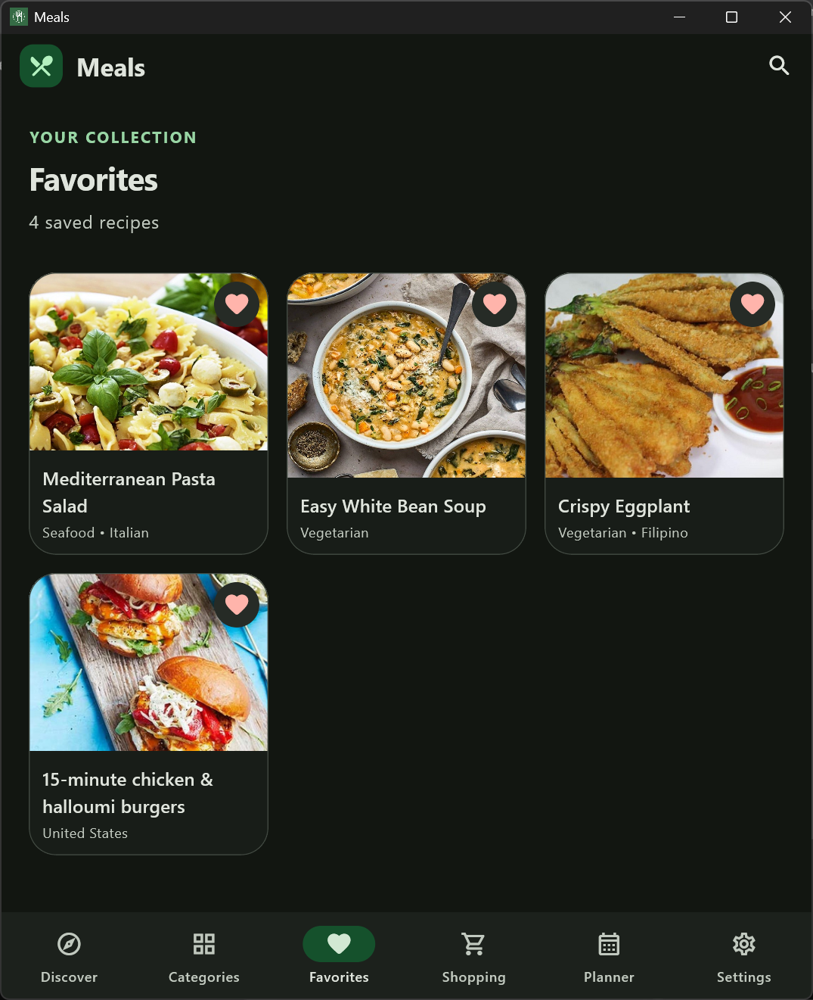
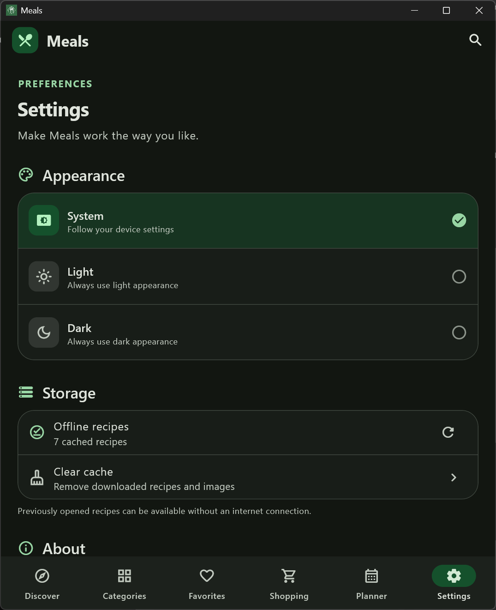
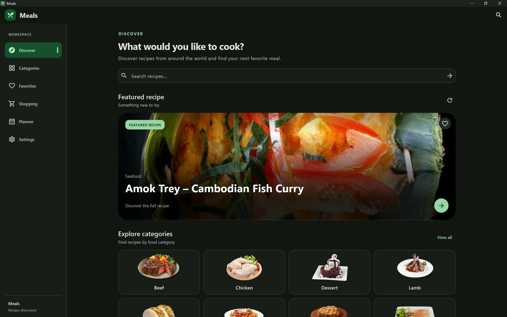

# Meals

[](https://github.com/incrediblesy/Meals/actions/workflows/ci.yml)


Meals is a cross-platform recipe discovery and meal planning
application built with Flutter and Clean Architecture.

Explore recipes from around the world, organize your favorite
meals, follow cooking instructions, create shopping lists and
plan your weekly meals in one application.


## Screenshots

| Discover Light | Search | Recipe Details |
|----------|--------|----------------|
|  |  |  |

| Cooking Mode | Shopping List | Meal Planner |
|--------------|---------------|--------------|
|  |  |  |

| Discover | Favorites | Settings |
|----------|-----------|----------|
|  |  |  |

### Desktop




## Features

### Recipe Discovery

- Featured and random recipes
- Browse recipes by category
- Alphabetical recipe browsing
- Responsive recipe grids
- Detailed recipe information

### Advanced Search

- Search by recipe name
- Filter by category, cuisine and ingredient
- Debounced name search
- Dynamic filter suggestions
- Persistent recent searches
- Protection against outdated API responses

### Favorites

- Save and remove favorite recipes
- Persistent local favorites
- Synchronized favorite buttons across screens

### Cooking Mode

- Step-by-step cooking instructions
- Ingredient checklist
- Cooking progress tracking
- Countdown timer with pause, resume and reset

### Shopping List

- Add ingredients directly from recipes
- Create and edit shopping items
- Track purchased ingredients
- Generate shopping lists from weekly meal plans

### Meal Planner

- Weekly meal scheduling
- Breakfast, lunch and dinner slots
- Persistent meal assignments
- Shopping list integration

### Offline Support

- Network-first recipe caching
- Offline access to previously cached recipe details
- Cached recipe images on supported native platforms
- Local favorites, shopping lists and meal plans
- Cache management

### Personalization

- Light, dark and system themes
- Persistent appearance preferences
- Responsive desktop and mobile navigation
- Keyboard shortcuts
- Reduced-motion support

## Technology Stack

| Technology | Purpose |
|------------|---------|
| Flutter | Cross-platform application |
| Dart | Programming language |
| material_ui | UI components |
| BLoC / Cubit | State management |
| GetIt | Dependency injection |
| Dio | HTTP networking |
| Equatable | Value equality |
| Dartz | Functional error handling |
| SharedPreferencesAsync | Local persistence |
| CachedNetworkImage | Image caching |
| FlutterCacheManager | Cache management |
| TheMealDB | Recipe data API |
| GitHub Actions | Continuous integration |

## Architecture

The project follows a feature-first Clean Architecture
approach with separate data, domain and presentation layers.

```text
lib/
├── core/
│   ├── cache/
│   ├── constants/
│   ├── di/
│   ├── errors/
│   ├── network/
│   ├── router/
│   ├── themes/
│   └── widgets/
│
├── features/
│   ├── categories/
│   ├── meals/
│   ├── search/
│   ├── favorites/
│   ├── shopping/
│   ├── planner/
│   └── settings/
│
├── app.dart
└── main.dart
```

```text
Presentation
     ↓
Domain / Use Cases
     ↓
Repository Contracts
     ↑
Data Implementations
     ↓
Remote API / Local Storage
```

## Getting Started

### Prerequisites

- Flutter SDK 3.50.1
- Dart SDK 3.14.0
- Git
- Platform-specific Flutter build tools

### Installation

```bash
git clone https://github.com/incrediblesy/Meals.git
cd Meals
flutter pub get
```

### Run the application

Windows:

```bash
flutter run -d windows
```

Android:

```bash
flutter run
```

Web:

```bash
flutter run -d chrome
```

## Keyboard Shortcuts

| Action | Windows / Linux | macOS |
|--------|-----------------|-------|
| Search | Ctrl + K | Cmd + K |
| Discover | Ctrl + 1 | Cmd + 1 |
| Categories | Ctrl + 2 | Cmd + 2 |
| Favorites | Ctrl + 3 | Cmd + 3 |
| Shopping | Ctrl + 4 | Cmd + 4 |
| Planner | Ctrl + 5 | Cmd + 5 |
| Settings | Ctrl + 6 | Cmd + 6 |

## Testing

```bash
dart format --output=none --set-exit-if-changed lib test
flutter analyze --fatal-infos --fatal-warnings
flutter test
flutter test --coverage
```

## Build

```bash
flutter build apk --debug
flutter build windows --release
flutter build web --release
```

Target platform compatibility must be verified through
successful builds and runtime testing.

## Continuous Integration

The GitHub Actions workflow performs:

- Code formatting checks
- Static analysis
- Unit and widget tests
- Coverage artifact generation
- Android builds
- Windows builds
- Web builds

## API

Recipe data and images are provided by
[TheMealDB](https://www.themealdb.com/).

The public test API key is intended for educational
and development use. Production distribution requires
appropriate API access under the provider's terms.

## Privacy

Meals stores preferences, favorites, search history,
shopping lists, meal plans and cached recipes locally.

Recipe searches and image requests communicate with
TheMealDB. The application does not require user accounts.

## Known Limitations

- Offline access is limited to previously cached recipes.
- Persistent offline image caching on web is not guaranteed.
- Cooking timers do not provide background notifications.
- Shopping quantities are not automatically converted.
- Meal plans support one recipe per meal slot.
- Cloud synchronization is not implemented.

## Changelog

See [CHANGELOG.md](CHANGELOG.md) for version history.

## Author

[incrediblesy](https://github.com/incrediblesy)

## Acknowledgments

- Flutter
- Material UI
- TheMealDB
- The open-source Dart and Flutter communities
